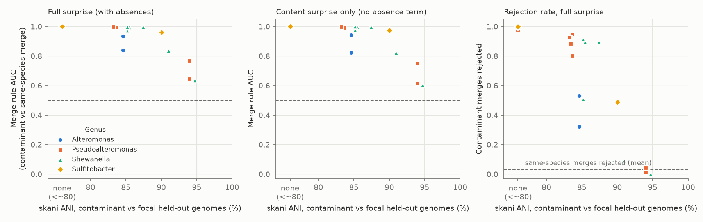

# Binning by surprise: same-genus contaminants (2026-11-18)

Follow-up to `binning_sim.md`, which found that the surprise-per-Mb merge rule separates foreign
from same-species merges with AUC 1.0 but never tested a contaminant from the same genus. Here the
rule is tested on 8 focal species in 4 marine genera, against 4-6 congeneric species each, from
below 80% ANI up to 94.7%.

**Short answer.** The rule holds up to about 90% ANI and fails at 93-95%.

- **Below about 83% ANI** (where skani reports no ANI): every merge is separated (AUC 0.99-1.0).
  The rule rejects 98-100% of contaminant merges and 1-8% of same-species merges.
- **At 83-90% ANI:** the ranking stays good (AUC 0.84-1.0), but the fixed threshold (excess > 0)
  lets many contaminants through. It rejects only 32-95% of contaminant merges, and fewer when
  the bin is incomplete.
- **At 90-91% ANI:** the AUC is 0.84-0.96, and the rule rejects 9-49% of contaminant merges.
- **At 94-95% ANI:** the AUC is 0.64-0.77, close to chance, and the rule rejects 0-4% of
  contaminant merges, no more than same-species merges (2%). Here 88-91% of the contaminant's genes
  land in the focal pangenome's families at 80% identity, against 93-94% for another strain of the
  same species.

So the rule breaks down where gene content stops telling the two species apart. That is roughly
the 95% ANI species boundary, made worse by the 80%-identity family cut.

Two smaller results:

- **Incomplete bins.** The zero-excess threshold is set by the bin's own bits/Mb, and that cost is
  inflated by the families missing from an incomplete bin. Two fixes were tested:
  - A threshold calibrated per species on same-species merges (rejecting the top 5%) recovers most
    of the 83-90% band: 84-100% of contaminant merges rejected.
  - Dropping the absence term ("content-only" surprise) rejects more contaminants, but also 23-38%
    of same-species merges.
- **Duplication.** Marker duplication again ranks contaminants and strains the wrong way round
  (AUC 0.0-0.6), as in the first wave.



## Setup

Code: `experiments/binning_sim_genus/`. Data and full tables:
`/data/scratch/metapanclust_data/binning_sim_genus/` (`results/summary.md`, `results/pairs.tsv`,
`results/pieces.tsv`, `results/calibrated_threshold.{md,tsv}`, `results/sim_*.tsv`).

| Script | What it does |
|---|---|
| `00_select.py` | picks the genomes |
| `01_download.sh` | downloads them from NCBI Datasets |
| `02_build.sh` | builds pangenomes, gene calls, mmseqs searches and skani ANI |
| `03_simulate.py` | simulates and scores the bins |
| `04_analyze.py` | AUCs and rejection rates per pair and ANI bin |
| `06_plot.py` | the figure |
| `07_threshold.py` | the calibrated threshold |
| `05_run.sh` | runs 03, 04, 06 and 07 |

The whole run took about 35 minutes wall-clock at 3 threads under `nice -n 15`, roughly
1-1.5 CPU-hours. Almost all of it was PPanGGOLiN, at 3-5 minutes (about 12 CPU-minutes) per species; the simulation takes a few seconds per species.

### Genomes

All genomes are GTDB r226 isolate genomes (`ncbi_genome_category` none) with CheckM2 ≥ 95%
complete, ≤ 2% contamination and ≤ 200 contigs. They were drawn at random from the least
fragmented candidates.

Genera were chosen for marine relevance and for having at least two species with ≥ 15 such
genomes. Sulfitobacter is the Chesterfield-relevant one: it is a Roseobacter-clade genus, in the
same family as the Chesterfield Amylibacter and Planktomarina bins. None of the Chesterfield
genera themselves (Pseudothioglobus, Amylibacter, Planktomarina, UBA9145, ...) has two species with
≥ 15 HQ genomes.

| Genus | Focal species (15 training + 4 held-out each) | Other congeneric contaminant species (2 genomes each) |
|---|---|---|
| Sulfitobacter | mediterraneus, pontiacus | mediterraneus_A, geojensis, faviae, dubius |
| Pseudoalteromonas | distincta, arctica | atlantica, tetraodonis, nigrifaciens, ruthenica |
| Shewanella | baltica, putrefaciens | hafniensis, oncorhynchi, vesiculosa, algae |
| Alteromonas | macleodii, mediterranea | stellipolaris, australica, naphthalenivorans, hispanica |

- **Contaminants of each focal species:** the other focal species of its genus (held-out genomes)
  and the 4 extra species, so 5 congeneric species per focal and 40 pairs in all.
- **Far contaminant:** *Flavobacterium psychrophilum* (Bacteroidota), 2 genomes.
- **Total:** 186 genomes, 0.8 GB.

### Pangenomes

Each focal species got `ppanggolin all` on its 15 training genomes, default parameters. Each has
4,786-8,947 families, of which 3,022-3,893 are persistent. Within each species, skani ANI among the
held-out genomes is 97.0-100%.

### Gene assignment

This differs from the first wave, which ran `ppanggolin projection` per genome. Here, genes of all
non-training genomes were called once with pyrodigal. Each gene was then searched with mmseqs
(`easy-search`, 30% identity, 50% coverage of both sequences, best hit) against each focal
pangenome's family representatives (`ppanggolin fasta --prot_families all`):

- **strict:** a gene belongs to its best-hit family if the hit has ≥ 80% identity and ≥ 80%
  coverage of both sequences, PPanGGOLiN's default cut;
- **relaxed:** any hit passing the search thresholds (30% identity, 50% coverage) counts;
- **foreign:** a gene with no strict family.

### Distances

ANI comes from `skani dist`: each contaminant genome against each held-out genome of the focal
species, averaged per species pair. skani reports nothing below about 80-83%, so those pairs are
labelled "no skani".

Each table also gives `strict_frac`, the fraction of the contaminant's genes that map strictly to
the focal pangenome. It is a second, gene-content distance, and it is available for every pair.

### Simulated bins

Bins were built from 50-kb pseudo-contigs, with 3 replicates. Each held-out genome x is the base,
either whole or reduced to 70% of its length, and is merged with one of:

- another held-out strain of the same species ("strain");
- each congeneric species;
- the far contaminant.

Each addition is 5, 10, 20 or 40% of x's length. On top of that, 10 single contigs of ≥ 20 kb were
offered to the 70% base from:

- x's own removed part;
- another strain;
- each contaminant species.

That makes 996 bins per focal species and 7,968 in all.

### Scores

The scores are the same as in the first wave:

- **comp:** completeness over single-copy persistent markers.
- **dup / dup_rel:** marker duplication, from strict and relaxed assignments.
- **foreign:** the foreign gene fraction.
- **S_tot:** total surprise in bits (present -log2 p, absent -log2(1 - p·comp), each foreign gene
  -log2 1/(n+2)).

**Merge rule:** excess = ΔS / Mb added - S(bin)/Mb; reject if excess > 0.

Two new things are scored:

- **excess_content:** the same rule on present + foreign terms only, with no absence term.
- **Calibrated threshold:** reject if ΔS / Mb added exceeds the 95th percentile of same-species
  merges into that focal species.

**AUC:** P(excess of the contaminant merge > excess of a strain merge) at equal added fraction and
base, averaged over the fractions and the two bases.

## Results

### 1. Merge rule against ANI

Pooled over 5-40% added and both bases. Each pair is focal species × contaminant species:

| ANI bin | Pairs | AUC excess, mean (min) | AUC foreign, mean | AUC dup_rel, mean | Contaminant merges rejected, mean (min) | Strain merges rejected | Contaminant genes mapped strictly |
|---|---|---|---|---|---|---|---|
| no skani (< ~83%), incl. far | 33 | 1.00 (0.99) | 1.00 | 0.20 | 1.00 (0.98) | 0.035 | 0.26 |
| 83-85% | 6 | 0.96 (0.84) | 0.97 | 0.39 | 0.74 (0.32) | 0.036 | 0.67 |
| 85-90% | 4 | 0.99 (0.97) | 0.99 | 0.24 | 0.81 (0.51) | 0.021 | 0.67 |
| 90-93% | 2 | 0.90 (0.84) | 0.92 | 0.38 | 0.29 (0.09) | 0.026 | 0.86 |
| 93-95% | 3 | 0.68 (0.64) | 0.70 | 0.53 | 0.02 (0.00) | 0.021 | 0.89 |

The hard pairs:

| Focal | Contaminant | ANI | Mapped strictly (strain) | AUC | Rejected at excess > 0, full / 70% base | Rejected, calibrated, full / 70% |
|---|---|---|---|---|---|---|
| Shewanella baltica | S. hafniensis | 94.7 | 0.91 (0.94) | 0.64 | 0.00 / 0.00 | 0.02 / 0.00 |
| Pseudoalteromonas arctica | P. distincta | 94.0 | 0.88 (0.93) | 0.77 | 0.06 / 0.02 | 0.38 / 0.15 |
| P. distincta | P. arctica | 94.0 | 0.89 (0.93) | 0.65 | 0.02 / 0.00 | 0.08 / 0.17 |
| Shewanella baltica | S. oncorhynchi | 91.0 | 0.85 (0.94) | 0.84 | 0.17 / 0.02 | 0.52 / 0.08 |
| Sulfitobacter mediterraneus | S. mediterraneus_A | 90.0 | 0.86 (0.99) | 0.96 | 0.79 / 0.19 | 0.92 / 0.96 |
| Alteromonas macleodii | A. mediterranea | 84.6 | 0.76 (0.93) | 0.84 | 0.48 / 0.17 | — |
| Alteromonas mediterranea | A. macleodii | 84.6 | 0.70 (0.93) | 0.93 | 0.75 / 0.31 | — |
| Shewanella baltica | S. putrefaciens | 85.2 | 0.75 (0.94) | 0.97 | 0.90 / 0.13 | — |

(The full per-pair table, calibrated threshold included, is in `results/pairs.tsv` and
`results/calibrated_threshold.tsv`.)

Points to note:

- **Breakdown.** The rule fails gradually between about 90% and 95% ANI. By 94-95% the added genes
  of a congener cost 380-530 bits/Mb, against 280-350 bits/Mb for a same-species strain. That is
  within the spread of strains.
- **Gene-content distance predicts failure better than ANI.** Failure tracks `strict_frac`, the
  share of the contaminant's genes that fall into the focal families at 80% identity. All pairs
  with AUC < 0.8 have strict_frac ≥ 0.88. All pairs with strict_frac ≤ 0.76 have AUC ≥ 0.84.
- **Species-boundary cases.** The 94-95% pairs are close to GTDB's 95% species cut, and
  baltica/hafniensis is one of the "S. baltica-like" complexes. At this distance a pangenome rule
  cannot reasonably be expected to separate the two. Splitting them needs ANI against the bin's
  own core, or SNV/coverage evidence: strain-resolved tools rather than gene content.
- **The 80%-identity cut sets the failure point.** At 90-95% ANI most orthologs are above 80%
  amino-acid identity, so they are counted as the focal family. A tighter strict cut (e.g. 95%) or
  per-family identity-to-representative distributions would move the breakdown towards 95%. This
  was not tested here.
- **The pair is asymmetric.** Sulfitobacter pontiacus vs mediterraneus_A is beyond skani range (27%
  of genes map strictly), but mediterraneus vs mediterraneus_A is 90.0%.

### 2. The zero threshold is miscalibrated for incomplete bins; ranking is not the problem

In the 83-90% band the AUC is 0.84-1.0, but the rule rejects only 32-95% of contaminant merges. The
cause is the base term S(bin)/Mb:

- a whole genome costs 350-860 bits/Mb;
- the same genome at 70% costs 880-1,290 bits/Mb, because of its absent families;
- a congener at 83-90% ANI costs 900-1,450 bits/Mb.

So the congener's contigs are accepted into incomplete bins. Rejection of contaminant merges:

| ANI bin | Excess > 0, full base | Excess > 0, 70% base | Calibrated, full | Calibrated, 70% |
|---|---|---|---|---|
| no skani | 1.00 | 1.00 | 1.00 | 1.00 |
| 83-85% | 0.87 | 0.60 | 0.92 | 0.84 |
| 85-90% | 0.97 | 0.64 | 1.00 | 0.96 |
| 90-93% | 0.48 | 0.10 | 0.72 | 0.52 |
| 93-95% | 0.03 | 0.01 | 0.16 | 0.10 |

The calibrated threshold is the 95th percentile of the held-out strain merges, so it is an
optimistic bound: in practice it would have to come from training genomes, e.g. leave-one-out
pieces. Per species it is 170-940 bits/Mb.

The content-only variant (no absence term) is not the fix. It rejects 97-100% of contaminants below
90% ANI, but also 23-38% of same-species merges: a strain brings accessory families that are rare
in the pangenome.

### 3. Single contigs (20-50 kb) onto the 70% base

| ANI bin | AUC vs own/strain contigs | Contaminant contigs rejected | Own contigs rejected | Strain contigs rejected |
|---|---|---|---|---|
| no skani | 0.99 (min 0.95) | 0.96 | 0.05 | 0.04 |
| 83-85% | 0.90 | 0.46 | 0.05 | 0.03 |
| 85-90% | 0.89 | 0.45 | 0.03 | 0.13 |
| 90-93% | 0.74 | 0.14 | 0.08 | 0.05 |
| 93-95% | 0.47 | 0.06 | 0.08 | 0.03 |

Contig moves behave like merges, except that the threshold problem is worse here. Every contig is
offered to a 70% base, and a single 20-50 kb contig is noisier. Even at 83-90% ANI, only half of the
congeneric contigs are rejected.

### 4. Duplication and foreign fraction

- **Strict duplication:** AUC 0.0-0.6 against strain merges.
- **Relaxed duplication:** AUC 0.0-0.6 against strain merges.

At 93-95% ANI, a congener duplicates markers about as much as a strain does, so duplication only
approaches 0.5 because neither has an edge. The foreign fraction alone gives the same or slightly higher AUCs than S_tot
(by at most 0.05). As in the first wave, S_tot carries essentially the foreign-gene signal for this
task.

## Limits

- **Few pairs above 90% ANI:** 5 pairs from 3 genera (Shewanella, Pseudoalteromonas, Sulfitobacter).
  The 85-95% band has only 9 pairs, and some pair types come from a single genus.
- **Small pangenomes:** 15 training genomes per species. With more genomes, accessory families of
  the focal species would be better covered, so strain cost would fall. Congener cost might fall
  too, through shared accessory families.
- **Isolates only:** clean, near-complete genomes. Real bins are MAGs, with fragmented contigs and
  their own contamination.
- **Pseudo-contigs:** 50-kb windows. Short contigs were not tested here; the first wave already
  showed that the rule fails below 10 kb.
- **Clonal held-out strains:** some held-out genomes are near-clonal (100% ANI in S. mediterraneus
  and S. baltica). That makes "strain" merges easy to accept: S. mediterraneus strains cost
  50 bits/Mb.
- **Gene assignment:** mmseqs best hit to family representatives with an 80/80 cut. This
  approximates `ppanggolin projection` but is not identical to it.
- **ANI coverage:** skani gives no ANI for pairs below about 83%. Those pairs are described by
  strict_frac instead (0.0-0.68).
- **Replicate noise:** 3 replicates per condition. Re-running with a different random draw order
  moved per-pair AUCs by up to 0.10 and rejection rates by up to 0.13. The ANI trend is unchanged.
  The numbers above are from the run on disk; `05_run.sh` reproduces them exactly.

## For grex: 200 focal species, ready to submit

The scripts are in `experiments/binning_sim_genus/grex/` and the plan is already selected. The run
covers 200 focal species in 195 genera, each with 15 training and 6 held-out HQ isolate genomes.
The contaminants are 802 congeneric species pairs plus a far contaminant, from 5,827 distinct
genomes.

### What it does

**Selection (done locally).**

- `p1_rep_ani.sh` computes skani ANI between GTDB r226 species representatives within each genus.
  It covers 265 genera with a possible focal species, giving 18,217 pairs, in about 6 min at
  3 threads.
- `p2_select.py` picks the focal species: those with ≥ 21 HQ isolates and at least one congener at
  88-97% ANI. Genera are taken round-robin, at most 3 per genus. That leaves 382 candidates, of
  which the first 200 are used.
- For each focal species it picks, at 2 genomes each:
  - up to 3 congeners at 88-97% ANI (the highest, the lowest and the median);
  - up to 2 congeners at 80-88%;
  - 1 congener below skani range;
  - *F. psychrophilum* as the far contaminant, or *E. coli* if the focal species is a Bacteroidota.

  The planned pairs, by representative ANI:

  | Class | Pairs |
  |---|---|
  | Close (88-97%) | 457 |
  | Mid (80-88%) | 194 |
  | Below skani range | 151 |

  The 457 close pairs break down as:

  | ANI | Pairs |
  |---|---|
  | 88-90% | 133 |
  | 90-92% | 109 |
  | 92-94% | 79 |
  | 94-95% | 69 |
  | 95-96% | 53 |
  | 96-97% | 14 |
- Output: `plan_full.tsv` with columns accession, species, genus, role, focal tag, representative
  ANI. Every row carries its focal tag, so a genome can be training data for one focal species and
  a contaminant for another.

**`g1_download.sh` (login node).**

- Downloads every genome from NCBI Datasets, sequentially, in batches of 100 with retries.
- Writes `plan.tsv`, which is `plan_full.tsv` minus any genome that failed to download.
- Re-runnable: it fetches only what is missing.

**`g2_job.sbatch` (one whole node).** Every step skips finished outputs, so resubmitting the same
job resumes it. The steps:

1. pyrodigal proteins for every non-training genome, 192-way parallel (`g_prot.sh`);
2. 53 focal species at a time, 3 threads each (`g_species.sh`):
   - `ppanggolin all` on the training genomes;
   - `ppanggolin fasta --prot_families all`;
   - mmseqs search of held-out and contaminant genes;
   - `03_simulate.py` at three strict family cuts: 80, 90 and 95% identity.

   The pangenome directory is then pruned to the files the analysis needs, to save inodes.
3. at the same time, skani ANI of each species' non-training genomes against its held-out genomes
   (`g_skani.sh`, danaSeq container). This uses env **`dana-mag-derep`**, not dana-mag-classify:
   that is the env with skani 0.3.1, as checked in `danaSeq/mag_analysis/envs/derep.yml` and
   `Dockerfile.base-slim`.
4. `g3_analyze.py` writes `results/pairs_grex.tsv` and `results/summary_grex.md`, with tables for
   each strict cut:
   - by genome ANI bin (80-85, 85-88, 88-90, 90-92, 92-94, 94-95, 95-96, ≥ 96);
   - by shared-gene fraction;
   - the ANI where the median AUC drops below 0.9 and below 0.75.

   The tables include merge AUC, foreign and dup_rel AUC, zero-rule rejection for whole and 70%
   bases, calibrated rejection, and single-contig AUC and rejection.

**Calibrated threshold.** The 6 held-out genomes are split into a calibration half and a test
half, with strain partners drawn within each half. The threshold is the 95th percentile of added
bits/Mb over calibration-half strain merges. It is applied only to test-half merges, for
contaminants and strains alike.

The original plan was leave-one-out pieces of the training genomes. That needs a pangenome rebuild
per genome, and the held-out split gives an honest estimate at no extra cost.

### Tested locally

- `03_simulate.py` gained an optional strict-identity argument and a plan-format genome table
  (env `GENOMES`). The local rerun of `05_run.sh` with the modified `03_simulate.py` reproduces every number in this
  report exactly (identical pair tables).
- One focal species (*Bartonella henselae*: 31 genomes, 5 contaminant species) ran end to end
  through g1 → g2 → g3. It used the same scripts, with `run`/`runD` replaced by plain `bash -c` and
  the local ppanggolin 2.3.2 / skani 0.3.1. The species step took 30 s wall at 3 threads; a 4-5 Mb
  genome takes 3-5 min.
- Early signs from that one species:
  - At 92% ANI (*B. koehlerae*) the 80% cut gives AUC 0.94 and rejects 74% of contaminant merges
    into whole bins and 3% into 70% bins.
  - The 90% cut gives AUC 0.99 (100% and 65% rejected).
  - The 95% cut gives AUC 1.0 (100% and 100%).
  - Same-species merges are still rejected only 2% of the time at the 90% and 95% cuts.
  - The calibrated rule rejected 18-21% of test-half strain merges, against 5% nominal. With only
    3 calibration genomes, the threshold is noisy. Read `rejcal_strain` alongside `rejcal_*`.

### Resources

| | Estimate |
|---|---|
| Download | 5,827 genomes, about 26 GB uncompressed; 59 batches, roughly 30-60 min on the login node |
| Disk | about 35 GB in total |
| Files | about 12,000 |
| Compute | about 200 × 12 CPU-min = 40 CPU-h, plus skani and simulation |
| Wall time | at 53 species in parallel, about 30-60 min; the job asks for 2 h, and large genomes (Streptomyces-size) are the tail |
| Memory | under 4 GB per species, about 200 GB peak |

### Submission (on grex)

```bash
# 0. paths (scratch is a symlink: always use the resolved path)
S=$(readlink -f /home/rec3141/scratch)
BASE=$S/metapanclust/binning_sim_genus
mkdir -p $BASE/code
# 1. copy in, from the workstation (grid):
#      /data/dev/metapanclust/experiments/binning_sim_genus/   -> $BASE/code/        (whole directory, incl. grex/)
#      /data/scratch/metapanclust_data/binning_sim_genus/grex_plan/plan_full.tsv -> $BASE/plan_full.tsv
#    e.g. rsync -a .../experiments/binning_sim_genus/ <grex>:$BASE/code/ ; rsync -a .../plan_full.tsv <grex>:$BASE/
# 2. smoke test the containers (seconds):
export PATH=/opt/singularity-ce-4.4.1/bin:$PATH
singularity exec -B $S $S/metapanclust/sif/metapanclust-tools-0.1.sif bash -c \
  'ppanggolin fasta --help | grep -c prot_families; pyrodigal --version; mmseqs version; python3 -c "import pandas, numpy"'
singularity exec -B $S $(readlink -f /home/rec3141/GENICE/danaSeq/mag_analysis/.danaseq-mag-analysis.sif) bash -c \
  'source /opt/conda/etc/profile.d/conda.sh && conda activate /opt/conda/envs/dana-mag-derep && skani --version'
# 3. download on the login node (sequential; run inside tmux/screen, ~30-60 min; re-run to fill gaps)
bash $BASE/code/grex/g1_download.sh 2>&1 | tee $BASE/download.log
#    check the last two lines: "missing after download: N" and "plan.tsv: X of 6204 rows kept"
# 4. submit the whole-node job
cd $BASE && sbatch $BASE/code/grex/g2_job.sbatch
# 5. when it finishes: $BASE/binsim_genus-<jobid>.out has per-step counts;
#    results in $BASE/results/summary_grex.md and pairs_grex.tsv;
#    per-species failures: grep FAILED $BASE/logs/species.log, then logs/{all,fasta,mm,sim}_<tag>.txt.
#    If it hit the time limit, sbatch the same script again: finished species are skipped.
```

To bring the results back, copy `results/summary_grex.md`, `results/pairs_grex.tsv` and
`results/sim_*` (about 300 MB) to `/data/scratch/metapanclust_data/binning_sim_genus/grex_results/`.

If `ppanggolin fasta --prot_families` is missing from ppanggolin 2.2.1 (the smoke test prints 0),
every species fails at its `fasta` step (logs/fasta_<tag>.txt). No fallback has been written:
stop and report back. The option exists in the ppanggolin 2.x documentation, and only 2.3.2 was
tested here.
